# Interview pack

This pack describes the implementation and retained local tests. It makes no alpha, latency, throughput, or production-readiness claim. Read [CLAIMS](CLAIMS.md), [the study status](STUDY-REPORT.md), and [benchmark status](BENCHMARKS.md) before presenting it. Empirical results must be generated and reviewed before adding performance numbers here.

## Two-minute pitch

I built a stock forecasting research platform with a Rust data and inference runtime, PyTorch training, and a React inspector. The engineering problem was making it difficult to accidentally present a demo, a leaked experiment, or an incompatible model as a meaningful forecast.

The pipeline versions market snapshots, computes causal features, exports training data through Arrow, and fits scaling only on training folds. Model publication uses staged artifacts, hashes, and numerical parity checks. The API labels synthetic provenance and the UI displays it. Alpaca minute ingestion can supply requested forecasts when the completed-bar window and model are compatible; that path has local tests, while real account acceptance remains human-gated.

I added mutation-tested leakage canaries, optional model signatures, an append-only decision log, and empirical drift monitoring. A frozen daily study defines baseline comparisons, costs, seeds and a separate final holdout. That study has not run because its protocol needs human review. I therefore describe this as a research and validation platform, not a demonstrated profitable strategy. The next evidence I need is the real-data comparison, runtime measurements on its sealed model, and the operator-run paper session.

## Ten-minute walkthrough

Start with `configs/default.yaml` and the frozen `configs/study_daily.yaml`. Explain why a symbol, date range, source and dataset version are part of the experiment, and why a present-day universe is not survivorship-free.

Follow `rust/cli/src/handlers/data.rs` into versioned market storage, then `handlers/features.rs` into causal features and Arrow training export. Show that an availability timestamp is separate from a bar's nominal timestamp. Historical provider snapshots cannot retroactively certify first-publication history.

Open `python/ml/train_orchestrator.py` and `dataset.py`. Walk through index validation, purging, embargoing, train-only scaling, sequence construction and validation-based stopping. Show the canary tests and the saved mutation evidence; explain what the controls detect and what they cannot establish.

Follow staged model publication into `rust/inference/src/integrity.rs`. Separate numerical parity, hash integrity and optional signature authenticity. Show where the trusted public key enters through configuration and why accepting a key from the artifact itself would defeat the trust boundary.

Follow `rust/api/src/forecast.rs` through source/model compatibility checks and explicit provenance. Show the Alpaca window rules and synthetic banner. Then inspect `decisions.rs` and the `monitor` CLI: hashes link decisions to packages and inputs, later outcomes are appended, and drift can produce a nonzero halt status for a supervisor.

End with the claims ledger and evidence. Show the frozen study runner's approval and one-use holdout guards. Explain the remaining real-data, provider and host gates before discussing further research.

## Architecture

```mermaid
flowchart LR
    Historical[CSV or Yahoo helper] --> Ingest[Rust validation and versioned snapshots]
    Alpaca[Alpaca WebSocket] --> Journal[Capture journal and bounded minute window]
    Journal --> Ingest
    Ingest --> Features[Causal Rust features]
    Features --> Arrow[Arrow training dataset]
    Arrow --> Train[PyTorch training and frozen baseline study]
    Train --> Package[Staged checkpoint and ONNX package]
    Package --> Gate[Hashes, parity and optional trusted signature]
    Gate --> Runtime[tract inference]
    Features --> Runtime
    Journal --> Forecast[Requested compatible live forecast]
    Runtime --> Forecast
    Forecast --> Log[Append-only decisions and outcomes]
    Log --> Monitor[Rolling metrics and feature drift]
    Forecast --> UI[React inspector with provenance]
```

The Node-hosted bridge and standalone Rust application have different public routes and live capabilities. The diagram describes data flow, not a claim that every deployment exposes every path.

## Questions and grounded answers

**Why an LSTM rather than GBM or a transformer?** It is a sequence-model hypothesis and the existing model architecture, not a proven winner. The frozen study compares it with zero, momentum, ridge and gradient-boosted trees using the same feature sequences and evaluation dates. A transformer adds complexity without current comparative evidence. If the final evidence does not establish LSTM superiority, report that plainly and prefer the simpler model where appropriate.

**How did you prevent lookahead and survivorship bias?** Availability checks, forward-label alignment, purged/embargoed splits and train-only scaling address specific leakage paths. Mutation tests demonstrate that the controls are exercised. Survivorship bias has not been eliminated: the frozen universe was selected with present-day knowledge. Provider revisions and corporate actions remain limitations, so do not claim a historically point-in-time universe.

**Why Rust runtime and Python training?** Rust owns data validation, feature computation, inference, APIs and replay, while Python provides model training and export. Python is not exclusively used for training: Yahoo ingestion and study orchestration also use Python helpers. Artifact schemas and parity gates bridge the boundary. Runtime performance remains to be measured on a real-data model.

**What does the backtest assume about fills, slippage and impact?** The frozen study generates signals after completed closes, enters at the next observed open and exits at that bar's close using fixed per-side costs. It is long-or-cash with independent equal-capital symbol sleeves. These are simulated prices and costs; neither capacity, queue position, dividends, borrow nor market impact is certified. The model's close-to-close target differs from its executable open-to-close return, and both are retained.

**How do you detect decay?** Saved train-only empirical features provide the KS reference. Monitoring selects the exact package and feature schema, excludes synthetic forecasts, deduplicates repeated decisions, and reports drift plus rolling IC and hit rate when outcomes are available. Thresholds are operational choices. A halt exits the monitoring command; the operator must connect that signal to a supervisor. Human-supplied outcomes and causal attribution of drift remain unverified.

**How did you account for multiple testing?** Freeze the universe, dates, costs, models, seeds and caps before fitting. Append every model attempt, including failures, to a durable ledger. Keep final evaluation behind a separate one-use sign-off. Report block-bootstrap uncertainty and an assumption-dependent deflated Sharpe diagnostic using logged attempts. Correlated trials make the effective independent count uncertain. CSCV/PBO is not implemented and must remain unavailable rather than invented.

**Why tract rather than ort?** The implemented Rust runtime loads ONNX through `tract-onnx`; the Python export checks also use ONNX Runtime. This matches the repository's current deployment and operator support. It does not prove tract is faster or numerically superior. The benchmark tooling compares all runtimes on the same sealed model, windows and CPU settings; measurements are blocked until a real-data package exists.

**What is verified?** Local tests cover provenance, artifact rejection, canary mutations, deterministic live-window behavior, monitoring drift and signature rejection. GitHub evidence is revision-specific. Real predictive advantage, actual-provider operation, host shutdown/SSE behavior under deployment conditions, load, retention and restore remain unverified. Consult the claims ledger rather than extrapolating from a passing unit test.

## Resume wording currently supported

- Built a Rust and PyTorch forecasting research platform with versioned data, causal features, train-only preprocessing and parity-gated model publication.
- Added mutation-tested leakage controls, explicit synthetic provenance, optional artifact signatures, and auditable forecast decisions with drift monitoring.
- Implemented an approval-gated study comparing an LSTM with statistical and tree baselines; real-data evaluation remains pending.

After evaluation, revise the final bullet to “evaluated an LSTM against baselines” and attach only numbers reproduced in the study or benchmark reports. If superiority is not established, say so. Do not replace missing measurements with estimates or synthetic metrics.

## What I would do with more time

Complete the reviewed study and separately authorized holdout, measure the sealed model, and collect the human paper-session evidence. Then address historically point-in-time universe construction, corporate actions and data licensing, calibrated monitoring thresholds, independently anchored audit logs, key rotation, and host-specific load/recovery acceptance. Broader models or markets should follow evidence of a research need.
