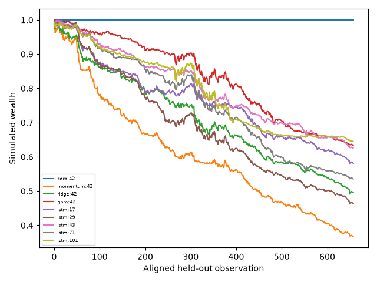

# Real data baseline study

Stage: development. Configuration SHA256: `436e8abf43eb8776322c14214c3fd88eb5dd12f21d5a3ed5879aeff201e41d85`.

Development results only; final holdout remains unevaluated. No LSTM advantage claim is justified.

This is a fixed present-day stock sample with survivorship bias, provider revisions and unverified corporate-action treatment. Simulated next-open fills are not executable quotes. No alpha claim follows from development folds.

| Candidate | After cost Sharpe | Sharpe interval | Drawdown | Turnover | IC mean | Rank IC mean | IC HAC t | Rank IC HAC t | Hit rate | DSR |
|---|---|---|---|---|---|---|---|---|---|---|
| zero:42 | null | null | 0.0 | 0.0 | null | null | null | null | 0.0 | null |
| momentum:42 | -4.290173630981664 | [-5.309517047130696, -3.2841290106984724] | -0.6336014101151339 | 1.1868434138705453 | -0.03291622123443882 | -0.037922451447795054 | -1.20580908480989 | -1.2288885860539531 | 0.4959989838689191 | 1.5188204360240704e-27 |
| ridge:42 | -3.3196524650954564 | [-4.328351257477903, -2.237562598641252] | -0.5089355043413237 | 0.966162395646722 | 0.008826057562688372 | -0.0016550107833830565 | -1.7143079343382668 | -1.5883924900035973 | 0.49244252508573605 | 7.507259992692595e-18 |
| gbm:42 | -2.4727181458073426 | [-3.576817337518834, -1.4621761342595487] | -0.3662939478463314 | 0.6858034131280366 | 0.002670628230950769 | -3.868165899207262e-05 | -1.2228759327710081 | -0.9887349144009687 | 0.4910453448494856 | 4.512408288787875e-12 |
| lstm:17 | -3.044860529723479 | [-4.09806665565043, -1.9987678030948255] | -0.4214795014161925 | 0.8289505249130824 | 0.005315671713069487 | 0.009752996243350244 | -0.1372602889638362 | 0.6103583818759016 | 0.5010796392734663 | 1.897462842141709e-17 |
| lstm:29 | -3.450222079098759 | [-4.748908050925035, -2.2710840983048413] | -0.5378185815661838 | 1.0718126029004051 | -0.0023073239051187894 | -0.0010475499187100063 | 0.6170996391498119 | 0.5105446137584075 | 0.5024768195097168 | 5.209597752657284e-17 |
| lstm:43 | -3.046549959359427 | [-4.10646167164193, -2.0194125348365994] | -0.3746833630314983 | 0.7025166287672076 | 0.008519201171896104 | 0.0059841267177938645 | 0.5984721465671944 | 0.734625674554972 | 0.49422075447732755 | 3.2599298431371623e-15 |
| lstm:71 | -3.2122542100402707 | [-4.2194093217329165, -2.2639732095514775] | -0.4651626410593279 | 0.8098079373396191 | -0.005268383741040866 | -0.003907964863965204 | -0.9849525025962953 | -1.602462212036078 | 0.48748888606630253 | 1.8253330120339294e-17 |
| lstm:101 | -2.1930019591863266 | [-3.1649758818335862, -1.2666588782621018] | -0.35564197797160957 | 0.6259804878140178 | 0.004478648594016259 | 0.008691317151782469 | -1.0686483525910453 | -0.7028534702368973 | 0.49244252508573605 | 2.6264635660169647e-11 |

LSTM seed summaries and paired comparisons are retained verbatim in results JSON:

```json
{
  "lstm_seed_summary": {
    "after_cost_sharpe_mean": -2.9893777474816523,
    "after_cost_sharpe_std": 0.4750296866158877
  },
  "paired_comparisons": {}
}
```

Undefined statistics remain null. DSR uses all logged attempts as a conservative count; independence assumptions are not certified. PBO is unavailable: CSCV is not implemented in this walk-forward study.

[Deflated Sharpe method](https://davidhbailey.com/dhbpapers/deflated-sharpe.pdf).

Results source: `reports\studies\436e8abf43eb8776322c14214c3fd88eb5dd12f21d5a3ed5879aeff201e41d85\development-results.json`. The report is generated from that JSON, not manually transcribed.



[Retained results JSON](evidence/phase5/436e8abf43eb8776322c14214c3fd88eb5dd12f21d5a3ed5879aeff201e41d85-development-results.json).

## Reproduce the saved report

Install the locked study dependencies with `uv sync --locked --group study` from `python/`. From the repository root:

```powershell
python/.venv/Scripts/python.exe scripts/run_daily_study.py --approved-sha256 436e8abf43eb8776322c14214c3fd88eb5dd12f21d5a3ed5879aeff201e41d85 --stage report
```

This reads saved results without acquisition or fitting. The original authorized development command uses `--stage development`. A completed or partial stage refuses automatic retrial. Final holdout requires a separate human sign-off and `--stage holdout --holdout-signoff REVIEWED_SHA256`; do not remove its one-use marker.

Trial ledger, predictions, snapshot hashes and plot: `reports/studies/436e8abf43eb8776322c14214c3fd88eb5dd12f21d5a3ed5879aeff201e41d85/`. Retain these local artifacts together with the evidence log; the source data and trained packages are not automatically published to Git.
